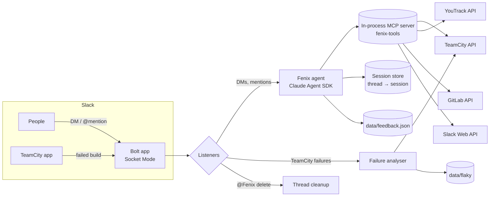

<div align="center">


# Fenix

**An AI DevOps teammate that lives in Slack.**

Fenix explains why your CI broke, tracks flaky tests over time, manages YouTrack tickets, and reads your codebase,
all from a Slack thread. Built on [Bolt for JavaScript](https://tools.slack.dev/bolt-js/) and the
[Claude Agent SDK](https://platform.claude.com/docs/en/agent-sdk/overview).


[Features](#features) · [Tools](#tool-catalog) · [Architecture](#architecture) · [Configuration](#configuration) · [Deployment](#deployment) · [Development](#development)

</div>

---

## Why Fenix

CI notifications tell you *that* a build failed. Fenix tells you **why**, **since when**, and **whose change most likely
caused it**, as a threaded reply under the notification, before anyone has opened a browser tab.

Beyond that, Fenix is a conversational agent with direct, scoped access to the systems an engineering team lives in
(TeamCity, YouTrack, GitLab), so questions like *"what broke the frontend e2e suite this morning?"* or *"open a bug
for this and assign it to me"* get answered in the thread where they were asked.

## Features

| | Capability | What it does |
|---|---|---|
| 🔴 | **Automatic build-failure analysis** | Watches TeamCity notifications in Slack and replies in-thread with new vs. pre-existing failures, flaky tests, the real error behind Cypress/Docker boilerplate, and a ranked list of likely-culprit commits. Workers SIGKILLed by the host (OOM) are reported as infrastructure, not blamed on commits. |
| 📈 | **Grafana alert analysis** | Explains each Grafana alert from real metrics and logs: whether load was real CPU pressure or waiting tasks, which Phoenix checks failed, whether the machine is unreachable, which errors coincided, how often it repeats, and what to do next. Fleet-wide alerts are reported as one central cause. |
| ♻️ | **Flaky-test tracker** | Answers "what's flaky?", "what got worse this week?", and "when did this test start failing?" from TeamCity's test history. |
| 🎫 | **YouTrack assistant** | Search, read, create, and update issues in natural language, with explicit confirmation before any write. |
| 🧭 | **Codebase navigator** | Read-only GitLab access to search code, read files, browse directories, and inspect recent commits. |
| 📝 | **"Create YouTrack Ticket" shortcut** | Message shortcut that turns any Slack message (and its surrounding context) into a pre-filled ticket. |
| 📊 | **Usage tracking** | Every agent reply ends with its model, tokens, cost and steps, plus the month to date. Every run is logged to a monthly file, and `report` gives a full usage report computed in code (no AI tokens). |
| 🔌 | **Claude Code connection (MCP)** | An authenticated MCP endpoint serves Fenix's read-only tools (TeamCity, flaky tests, server health, codebase, YouTrack search, usage) to Claude Code, plus `slack_send_message` for the owner, so Claude can write a message and post it as Fenix. All service tokens stay on the Fenix server. |
| 🧹 | **Thread cleanup** | `@Fenix delete` removes every message Fenix posted in a thread. |
| 💬 | **Feedback loop** | 👍/👎 buttons on every answer plus conversational feedback capture, stored for the owner to review. |
| 🛡️ | **Guardrails** | Owner allowlist, prompt-injection and credential-probing detection with strikes, a strict tool allowlist, and redaction rules. |

## How to talk to Fenix

| Where | How | Behaviour |
|---|---|---|
| **Direct message** | Just write | Fenix answers in a thread and keeps context across follow-ups. |
| **Channels and threads** | `@Fenix <question>` | Fenix replies **only when mentioned**, including inside threads it already joined. A mention resumes that thread's conversation. |
| **TeamCity notifications** | Nothing; automatic | Failed-build messages from the TeamCity app get an analysis reply, no mention needed. |
| **Grafana alerts** | Nothing; automatic | Each firing alert from the Grafana app gets an analysis: in the alert's thread (`grafana.replyMode: "thread"`) or as a preview in the admin DM (`"dm"`). |
| **App Home** | Open the Home tab | A summary of what Fenix can do and how to reach it. |
| **Assistant panel** | *Add Agent → Fenix* | Suggested prompts for builds, flaky tests, and tickets. |
| **Message shortcut** | ⋯ → *Create YouTrack Ticket* | Opens a ticket form pre-filled from the message. |

### Commands

| Command | Who | Effect |
|---|---|---|
| `report [period]` (DM) / `@Fenix report [period]` | Owners | Full usage report: replies, tokens, cost, cache share, per-reply averages and p50/p95 time, by model, user, day and tool, costliest replies, and rule-based analyses. Period: `7d`, `24h`, `last-month`, `2026-10`; default this month. Built in code, so it costs no AI tokens. |
| `@Fenix delete` | Owners | Deletes every message Fenix posted in the current thread (parent included, if Fenix posted it), then confirms privately. Anyone else is ignored silently. |

## Tool catalog

Fenix's agent can only call the tools below. It runs with Claude Code's built-in tools (`Bash`, `Read`, `Write`,
`Edit`, `WebFetch`, `WebSearch`) explicitly disabled and an allowlist that contains nothing else.

### TeamCity CI/CD

| Tool | Purpose |
|---|---|
| `teamcity_list_builds` | Recent builds for a configuration, filterable by status. |
| `teamcity_build_details` | Status, duration, agent, and trigger info for one build. |
| `teamcity_build_failures` | Failed tests in a build, flagged as new or pre-existing. |
| `teamcity_build_changes` | Commits included in a build and their authors. |
| `teamcity_test_detail` | Full error output for one failed test. |
| `teamcity_list_configs` | Discover build configuration IDs. |

### Flaky-test tracker

| Tool | Purpose |
|---|---|
| `teamcity_flaky_tests` | Recently failing tests whose fail rate is between 15% and 90%. |
| `teamcity_flaky_trends` | Tests whose fail rate rose between two time windows. |
| `teamcity_test_timeline` | Pass/fail history of one test, with partial-name search. |

> **TeamCity is the source of truth.** Every fail rate, label, trend, and timeline is computed from TeamCity's test
> history (up to 60 runs per test). A test failing in 90% or more of its runs is **broken**, not flaky, and at least
> 3 runs are needed before a test is labelled. Fenix also keeps a local *failure log* from build notifications
> (`data/flaky/`), used only to find candidate tests and to match partial names: notifications only cover failed
> builds, so the log cannot produce fail rates on its own. Infra kills (test workers SIGKILLed by the host, see
> below) never enter the log, so they cannot inflate a test's apparent flakiness.

### YouTrack

| Tool | Purpose |
|---|---|
| `youtrack_search` | Search with YouTrack query syntax (`project: DEV State: {In Progress}`). |
| `youtrack_get_issue` | Full issue details: description, fields, comments, links. |
| `youtrack_my_issues` | Shortcut for someone's open issues. |
| `youtrack_create_issue` | Create an issue with type, priority, and assignee. **Requires confirmation.** |
| `youtrack_update_issue` | Change state, assignee, or priority, or add a comment. **Requires confirmation.** |

### Codebase (GitLab, read-only)

| Tool | Purpose |
|---|---|
| `repo_search_code` | Search code across the configured repository. |
| `repo_read_file` | Read a file, with optional line ranges (truncated at 25k chars). |
| `repo_list_files` | Browse the directory tree. |
| `repo_recent_commits` | Recent commits, optionally scoped to a path. |

> Sensitive paths (`.env*`, keys and certificates, `*secret*`, `*credential*`, CI and compose files, `.npmrc`,
> SSH keys, and anything inside a directory with such a name) are blocked at the tool level: reads are refused, and
> search hits and directory entries for them are dropped, regardless of what the model asks for. The system prompt
> lists the same paths, generated from the one list in `integrations/gitlab.js`.

### Slack interaction

| Tool | Purpose |
|---|---|
| `add_emoji_reaction` | Acknowledge a message with a topic-appropriate reaction. |
| `mark_resolved` | Add ✅ to the thread's parent once an issue is resolved. |
| `save_user_feedback` | Store structured feedback (summary, category, sentiment, actionable) after the user confirms it. |
| `list_user_feedback` | *Owner only.* Review stored feedback with filters. |
| `feedback_stats` | *Owner only.* Aggregate feedback by category and sentiment. |

## Automatic build-failure analysis

When the TeamCity Slack app posts a failed build, Fenix pulls the build, its tests, its changes, and its log, then
replies in the notification's thread:

```text
Master_E2eFrontEnd | 42 min | agent-07 | View build

🔴 New failures (2):
  - invoices › creates an invoice with a delivery address   (3m 12s)
  👤 Likely cause:
      alice.example  a1b2c3d  IMPROVE: require a delivery address on invoices
      🏷️ touches delivery-address.service.ts, invoice.service.ts

♻️ Flaky tests (1):
  - customers › search paginates   (34% fail rate)

🟡 Pre-existing (1):
  - reports › exports PDF
```

How it gets there:

1. **Real error extraction.** It strips Cypress `before all` boilerplate, `(new)` markers, and Docker/corepack noise
   to find the actual error, then fingerprints it.
2. **Error origin.** It walks back through previous builds of the same configuration to find where that fingerprint
   first appeared, so a failure that started three builds ago isn't blamed on today's commits.
3. **Commit scoring.** Commits are ranked by how strongly their changed files match the failing tests and the error
   text, including German domain terms mapped to English code names (e.g. *Rechnung* to `invoice`, *Lieferadresse* to
   `delivery` and `address`). Merge commits are demoted.
4. **Historical correlation.** Files that changed in earlier builds where the same test failed add evidence.
5. **Classification.** Each failure is labelled new, pre-existing, flaky, or broken from its TeamCity history.
6. **Infra kills.** An occurrence whose name ends with `Jest failed to execute suite`, or whose details carry Jest's
   `terminated by another process: signal=SIGKILL`, means the host killed the worker (kernel OOM killer). Fenix
   reports it as infrastructure ("worker SIGKILLed, check agent memory, `journalctl -k` on the agent"), ranks no
   commit authors for it, and keeps it out of the failure log.

## Grafana alert analysis

When the Grafana Slack app posts a firing alert, Fenix reads everything it needs from the message itself: the
rule, each host with its exact start time (from the 🔍 logs link) and its labels (from the silence link). For each
firing host (up to three per message) it then pulls, read-only through a Grafana Viewer token:

- **Reachability:** when node_exporter last delivered a sample, and whether the Phoenix health exporter answers.
- **CPU and load:** load average against real CPU use by mode (user, system, disk wait, steal), processes running
  and blocked. A load spike with an idle CPU is called out as waiting tasks, not CPU pressure.
- **Memory, swap, disk:** peak memory use, swap growth, disk busy time, filesystem fill level and growth per day.
- **Phoenix health checks:** which `phoenix_*_from_py` checks dropped during the alert.
- **Logs (Loki):** volume per service and the most frequent error patterns, with errors that explain waiting tasks
  (pool exhausted, timeouts, connection resets) linked to the verdict.
- **Recurrence:** how often the same rule fired for the host in the last 24 hours and 7 days.

Each host gets a compact Block Kit card inside a Slack attachment, so its **left bar is coloured by status**,
matching the status emoji in the header (🔴 down, 🟠 needs action, 🟡 worth a look, 🟢 false alarm; grey for
fleet-wide events). Each metric always uses the same icon:

```text
🟢 app-01 · Not real CPU pressure
High System Load Over All CPU Cores Together · 🕒 since 23:42 · 🔁 4th time in 24 h · 12× in 7 days
Load 12.6 on 2 CPUs (629%), but the CPU was 86% idle. Tasks were waiting, not computing.

🧠 CPU             14% busy of 2 cores      📈 Load      peak 12.6 at 23:32 · 10 running
💾 Memory          67% used · swap flat      💽 Disk      busy 0%
🩺 Phoenix checks  all 6 healthy             📜 Logs      12.5k lines · 25 errors

⚠️ Top errors
> 10× phx-app  recv() failed (Connection reset by peer) while reading response header …
👉 Next step: Change the rule to measure CPU use instead of load average.
⚙️ Rule-based analysis of Grafana metrics and logs · no AI model, 0 tokens · 1.3 s
```

The footer is honest about cost: the analysis is deterministic code over Grafana data, so it never calls an LLM.

Five or more hosts in one alert line are treated as one fleet-wide event (network, monitoring, or a shared
dependency) instead of separate problems. Messages that only report recoveries get no reply.

## Usage tracking

Every Fenix run is appended as one JSON line to a monthly log, `data/usage/YYYY-MM.jsonl` (UTC months). The
current month's file is the only write target; files older than `usage.retentionMonths` (default 12) are deleted
when a new month starts. A line is about 0.5 KB and never contains message text:

| Field | Content |
|---|---|
| `kind`, `outcome` | `agent`, `grafana` or `teamcity`; `ok`, `error`, `timeout` or `busy` |
| `models` | Per model ID: fresh input, output, cache-read and cache-write tokens, and estimated cost |
| `costUsd`, `turns`, `durationMs` | Totals for the run, from the Agent SDK's final result |
| `tools` | Tool name → number of calls |
| `userId`, `userName`, `where`, `resumed` | Who asked, in a DM or a channel, and whether the thread continued a conversation |

Agent replies end with a footer such as
`🤖 sonnet-4-5 · 2.3k in · 800 out · 90.0k cache · $0.04 · 3 steps · 8.0 s · month: 1.23M tokens · $14.20`.
The month-to-date total is kept in memory, so the footer never re-reads the log.

Reports cost no tokens: `report` aggregates the log in code and renders a Block Kit card. Asking in natural
language ("how much did we spend this week?") uses the owner-only `usage_report` tool, which hands the model only
the finished summary.

## Claude Code (MCP)

Fenix can serve its tools to Claude Code over MCP (Streamable HTTP), so any Claude Code session can ask about builds,
flaky tests, server health, the codebase, YouTrack issues, or Fenix's own usage, while every service token stays on
the Fenix server.

- **Read-only by design:** `READ_ONLY_TOOLS` in `agent/tools/index.js` lists the static read-only tools (18). YouTrack
  create/update and Slack-bound tools are excluded, and every tool is marked `readOnlyHint`.
- **Slack tools** (from `createSlackMcpTools()`, sharing one cached workspace directory):
  - `slack_channels` (read-only, every connection): the channels Fenix can post in, with IDs: every public channel
    (no invite needed, thanks to `chat:write.public`) and the private ones it is a member of. Misspelled names get
    "did you mean" suggestions, and invite hints name the exact bot user.
  - `slack_users` (read-only, every connection): the people Fenix can message, with handle, user ID, title,
    active/away, custom status (vacation, sick, focus...) and when it clears, huddles, and local time.
  - `slack_send_message` (connections with the `send` scope; see *Other MCP clients*): posts as Fenix to `me` (a DM to the owner),
    `#channel`, `@person`, a Slack ID, or a thread given by its message link, and returns the message link. For a DM
    it also notes the recipient's status. It is not marked read-only, so Claude Code asks before each send; clients
    registered with Slack approval only draft, and OAuth sign-ins from Claude app connectors never get it.
  Ask a session, for example: *"Write a short Slack message about today's failed builds and DM it to me."*
- **One definition per tool:** the endpoint registers the same tool objects the Slack agent uses.
- **Authenticated:** requests need `Authorization: Bearer <FENIX_MCP_TOKEN>` (constant-time check); anything else
  gets `401`. The server is stateless (a fresh MCP server per POST) and refuses to start without a token.
- **Logged:** every call is recorded in the usage log as `kind: "mcp"` with the tool name, outcome, and duration.

- **Two ways to sign in:** Claude Code sends the static token as a header. Claude app connectors (claude.ai, desktop,
  mobile) cannot send headers, so the endpoint is also an **OAuth 2.1 authorization server** (MCP authorization spec):
  protected-resource and authorization-server metadata under `/.well-known/`, PKCE (S256) codes that work once,
  1-hour access tokens, and 30-day refresh tokens that rotate on every use. Tokens are stored only as SHA-256 hashes
  in `data/mcp-oauth.json`. Clients identify themselves in either of two ways:
  - **Client ID Metadata Document (CIMD)**, Claude's recommended option: the `client_id` is an HTTPS URL that Fenix
    fetches, only from `mcp.cimdOrigins` (Claude's origins). The document must name itself as `client_id`, be a
    public client, and list allowed redirect URIs (Claude's callback, or loopback on any port for Claude Code). The
    approval DM shows the verified origin, since the document's name is self-asserted.
  - **Dynamic client registration**, limited to `mcp.oauthRedirectUris` (Claude's callback URLs).
- **Every app sign-in is approved in Slack:** `/authorize` shows a "approve in Slack" page and Fenix DMs each owner
  an **Approve / Deny** button (only owners can decide; requests expire after 5 minutes). The page continues on its
  own once approved.

Enable it in `fenix.config.json` (`mcp.enabled`, `mcp.host`, `mcp.port`, `mcp.path`, and `mcp.publicUrl` for OAuth) and put it behind your HTTPS
reverse proxy; bind it to an address the proxy can reach but the internet cannot (for example Docker's host
gateway). If the address does not exist yet at boot, Fenix retries every 30 s instead of failing. Then:

```sh
claude mcp add --transport http fenix https://<your-fenix-domain>/mcp --header "Authorization: Bearer $(cat ~/.fenix_mcp_token)"
```

In the Claude app: *Settings → Connectors → Add custom connector*, enter `https://<your-fenix-domain>/mcp`, and approve
the request Fenix sends you in Slack.

### Other MCP clients (Cursor, Grok, ...)

The tools hold no model logic, so any MCP client that speaks Streamable HTTP with a bearer token can use them. Give
each client its own token, so it shows up by name in the logs and the usage report and can be revoked on its own:

| Connection | Tools | Sending as Fenix |
|---|---|---|
| `FENIX_MCP_TOKEN` (Claude Code) | all | direct; Claude Code asks before each tool call |
| Registered client, default | read-only | none |
| Registered client, `--send` | all | each message waits for an owner's **Send** click in Slack |
| Registered client, `--send --no-approval` | all | direct; only for clients that ask before each call |
| Claude app connector (OAuth) | read-only | none |

```sh
# Create a client on the server; only the token goes to stdout, straight into a file
npm run -s vps:mcp-client -- create grok --send > ~/.fenix_mcp_token_grok && chmod 600 ~/.fenix_mcp_token_grok
npm run -s vps:mcp-client -- list
npm run -s vps:mcp-client -- revoke grok      # creating the same name again rotates its token
```

Clients with Slack approval get the draft in each owner's DM with **Send / Discard** buttons; the tool call returns
straight away and says so. Drafts expire after 30 minutes and live in memory only.

**Grok CLI** (`~/.grok/config.toml`; Grok reads the token file on every request):

```toml
[mcp_servers.fenix]
url = "https://<your-fenix-domain>/mcp"
bearer_token_file = "~/.fenix_mcp_token_grok"
enabled = true
```

**Cursor** (`~/.cursor/mcp.json`, under `mcpServers`):

```json
"fenix": {
  "type": "streamableHttp",
  "url": "https://<your-fenix-domain>/mcp",
  "headers": { "Authorization": "Bearer <cursor token>" }
}
```

## Architecture



| Layer | Implementation |
|---|---|
| **Transport** | Bolt for JavaScript in Socket Mode; no public HTTP endpoint required. |
| **Agent** | `query()` from the Claude Agent SDK with a generated system prompt, `maxTurns: 15`, and a 120 s timeout. At most 3 agent runs execute concurrently, and one per thread. |
| **Tools** | Defined with `tool()` and Zod schemas, served by an in-process MCP server (`createSdkMcpServer`). Slack-bound tools are closures over the current channel and thread. |
| **Integrations** | `integrations/` holds the only TeamCity, YouTrack, GitLab, and Grafana clients (shared timeout and error format; TeamCity calls go through one limiter of 4 concurrent requests, at most 100 queued for up to 60 s). Agent tools and Slack listeners both import from it. |
| **Conversation state** | Only SDK session IDs are stored, keyed by `channel:thread_ts` (24 h TTL, 1,000 entries). Each mention or DM resumes its thread's session. |
| **Persistence** | Files under `data/`: feedback (last 500 entries), a per-configuration failure log, and monthly usage logs. |

## Configuration

Fenix keeps **secrets** in environment variables and **deployment-specific settings** in a git-ignored JSON file,
so the source stays generic.

### 1. Secrets (`.env`)

| Variable | Required | Description |
|---|---|---|
| `ANTHROPIC_API_KEY` | ✅ | Anthropic API key. |
| `SLACK_BOT_TOKEN` | ✅ | Bot token (`xoxb-…`). |
| `SLACK_APP_TOKEN` | ✅ | App-level token (`xapp-…`) with `connections:write`, for Socket Mode. |
| `TEAMCITY_TOKEN` | For CI features | TeamCity access token. |
| `YOUTRACK_API_TOKEN` | For YouTrack features | YouTrack permanent token. |
| `GITLAB_TOKEN` | For codebase features | GitLab token with `read_api`. |
| `FENIX_MCP_TOKEN` | For the MCP endpoint | Long random bearer token Claude Code must send (`openssl rand -hex 32`). |
| `GRAFANA_TOKEN` | For Grafana alert analysis | Grafana service-account token with the **Viewer** role. |
| `SLACK_USER_TOKEN` | Optional | User token (`xoxp-…`) so the ticket shortcut can read DM context. |
| `FENIX_CONFIG` | Optional | Path to the config file (default `fenix.config.json`). |

Every integration token can also be read from a dotfile in `$HOME` (`~/.teamcity_token`, `~/.youtrack_token`,
`~/.gitlab_token`, `~/.grafana_token`, `~/.slack_user_token`) when the variable is not set.

### 2. Deployment settings (`fenix.config.json`)

```sh
cp fenix.config.example.json fenix.config.json
```

| Key | Description |
|---|---|
| `teamName` | Team Fenix serves, used in its system prompt. |
| `ownerIds` | Slack user IDs allowed to use Fenix. Everyone else gets a friendly "not ready yet" reply. |
| `ownerName` | Name shown in access and error messages. |
| `adminDmChannel` | DM channel where messages from non-owners are forwarded (optional). |
| `teamcity.url` / `teamcity.botId` | TeamCity base URL and the Slack bot ID of the TeamCity app, whose failure posts trigger the analysis. |
| `teamcity.keyConfigs` | Build configurations the agent should know by name: `[{ "id", "description" }]`. |
| `gitlab.url` / `gitlab.project` | GitLab base URL and project path (`group/repo`) for the codebase tools. |
| `gitlab.defaultBranch` | Branch the codebase tools use when none is given (default `main`). |
| `youtrack.url` / `youtrack.project` | YouTrack base URL and default project key. |
| `grafana.url` / `grafana.botId` | Grafana base URL and the Slack bot ID of the Grafana app, whose alert posts trigger the analysis. |
| `grafana.prometheusUid` / `grafana.lokiUid` | Data source UIDs for metrics and logs. |
| `grafana.replyMode` | `dm` (default) sends analyses to `adminDmChannel` as a preview, `thread` replies under the alert, `off` disables it. |
| `mcp.enabled` / `mcp.host` / `mcp.port` / `mcp.path` | MCP endpoint for Claude Code (default off, `127.0.0.1:8787/mcp`). |
| `mcp.publicUrl` / `mcp.oauthRedirectUris` / `mcp.cimdOrigins` | Public HTTPS origin of the endpoint, which turns on OAuth sign-in for Claude app connectors; the callback URLs clients may register; and the origins whose client metadata documents may be fetched (defaults: Claude's). |
| `usage.retentionMonths` | Months of usage logs to keep (default 12). |
| `timeZone` | IANA time zone for times shown in Slack, matching the alerts (default `UTC`). |
| `contextFile` | Markdown appended to the system prompt (default `prompts/context.local.md`). |
| `dataDir` | Directory for persisted state: feedback and the failure log (default `data`). |

Integrations that are not configured fail with a clear message instead of guessing a URL.

### 3. Team knowledge (`prompts/context.local.md`)

Anything the agent should know about your team that doesn't belong in source, such as codebase layout and naming
conventions, goes here. See [`prompts/context.example.md`](prompts/context.example.md).

### Slack app

[`manifest.json`](manifest.json) is the version-controlled definition of the app: Socket Mode, the App Home and
Messages tabs, the agent view, the *Create YouTrack Ticket* shortcut, the bot scopes, and the bot events
`app_mention`, `app_home_opened`, `message.channels`, `message.groups`, and `message.im`. Create the app from it at
[api.slack.com/apps](https://api.slack.com/apps) (*From a manifest*), install it to your workspace, and invite Fenix
to the channels where TeamCity posts.

The Slack CLI project is set to a **remote** manifest (`.slack/config.json`), so `slack run` never overwrites the
app. To apply a change, edit `manifest.json`, paste it into *App Manifest* on api.slack.com, and reinstall if the
scopes changed.

## Getting started

```sh
git clone https://github.com/Yuri-Lima/fenix-slack-bot.git
cd fenix-slack-bot
npm install

cp .env.sample .env                              # add your tokens
cp fenix.config.example.json fenix.config.json   # add your owners and URLs

npm start
```

`Fenix is running!` in the log means the Socket Mode connection is up. Send Fenix a DM to try it.

## Deployment

Fenix is a single long-running Node.js process, which makes a small VPS with systemd a good fit.

```sh
cp .env.deploy.sample .env.deploy   # VPS host, port, SSH key, install path
npm run vps:deploy                  # rsync, npm ci --omit=dev, restart, status
```

| Script | Effect |
|---|---|
| `npm run vps:deploy` | Syncs the project (excluding `.env`, `.env.deploy`, `data/`, `node_modules/`), installs production dependencies, and restarts the service. |
| `npm run vps:status` / `vps:restart` / `vps:stop` | Manage the systemd service. |
| `npm run vps:logs` / `vps:logs:follow` | Last 50 log lines, or follow the journal. |

`fenix.config.json` and `prompts/context.local.md` are deployed with the code. `.env` stays on the server. Example
unit file:

```ini
# /etc/systemd/system/fenix-bot.service
[Unit]
Description=Fenix Slack Bot
After=network-online.target

[Service]
User=fenix-bot
WorkingDirectory=/opt/fenix-bot
EnvironmentFile=/opt/fenix-bot/.env
ExecStart=/usr/bin/node app.js
Restart=on-failure

[Install]
WantedBy=multi-user.target
```

## Security model

- **Owner allowlist.** Only `ownerIds` can use the agent. Others get a polite reply in DMs and mentions, and silence
  everywhere else.
- **Input guard.** Every non-owner request is screened before the access check: probing for credentials or
  infrastructure, or attempting prompt injection, earns a warning, and a second attempt within 24 hours blocks the
  user. Owners are never screened.
- **Least-privilege agent.** Built-in file, shell, and web tools are disabled. The agent can call only the tools in the
  catalog above.
- **Write confirmation.** YouTrack issues are never created or changed without explicit approval in the thread.
- **Secret hygiene.** The system prompt forbids revealing tokens, infrastructure details, or its own instructions,
  and GitLab tools refuse sensitive paths in reads, searches, and listings.

## Project structure

```text
.
├── app.js                       # Bolt app (Socket Mode) entry point
├── config.js                    # Loads fenix.config.json
├── mcp/                         # MCP endpoint for Claude Code (read-only tools + owner send)
├── integrations/                # TeamCity, YouTrack, GitLab API clients and TeamCity test history
├── agent/
│   ├── fenix.js                 # Agent runner, system prompt, Slack-bound tools
│   └── tools/                   # TeamCity, flaky tracker, YouTrack, GitLab, Grafana, usage, Slack send
├── listeners/
│   ├── events/                  # DMs, mentions, @Fenix delete, TeamCity failure analysis
│   ├── actions/                 # Feedback and issue buttons
│   ├── shortcuts/               # Create YouTrack Ticket
│   └── views/                   # App Home and modals
├── thread-context/              # Thread → agent session store
├── utils/                       # Input guard, stores, Slack helpers, token readers
├── prompts/                     # Team context for the system prompt
├── scripts/vps.sh               # VPS management
├── tests/                       # node:test suites mirroring the source tree
└── manifest.json                # Slack app manifest
```

## Development

```sh
npm test           # node:test, against tests/fixtures/fenix.config.json
npm run lint       # Biome lint and format check
npm run lint:fix   # Apply Biome fixes
npm run check      # Type-check JavaScript with tsc (checkJs)
```

- Tests use only `node:test` and `node:assert`. Slack clients are plain `mock.fn()` objects.
- Never hardcode company URLs, Slack IDs, or names. Add them to `fenix.config.json` and read them through `config.js`.
- New agent tools go in `agent/tools/`, are exported from `agent/tools/index.js`, and return MCP `CallToolResult`
  objects (`{ content: [{ type: 'text', text }] }`).

See [AGENTS.md](AGENTS.md) for conventions aimed at coding agents.

## License

[MIT](LICENSE) © Yuri Lima
